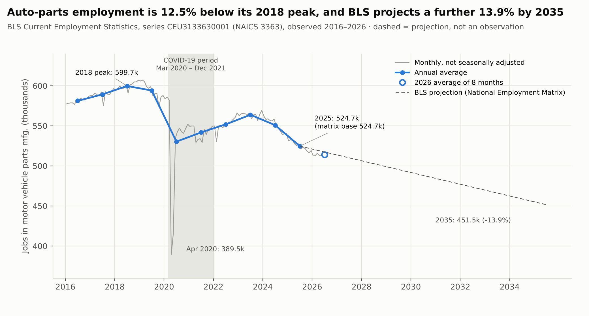
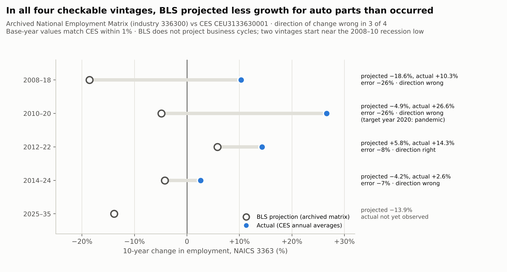
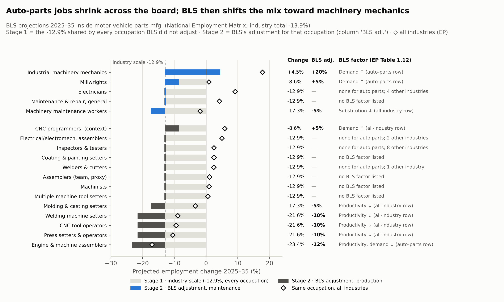
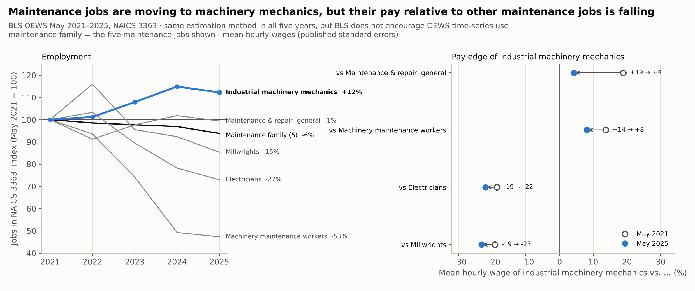
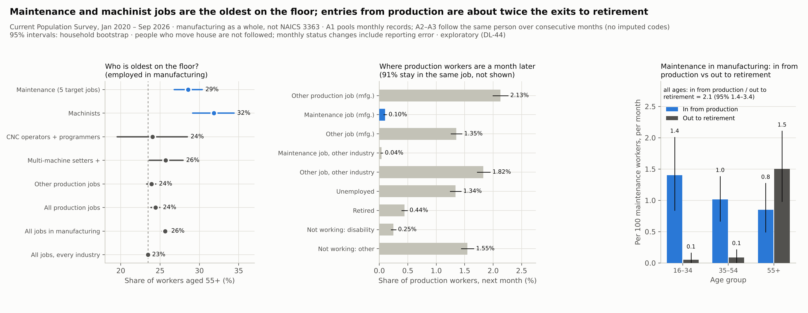
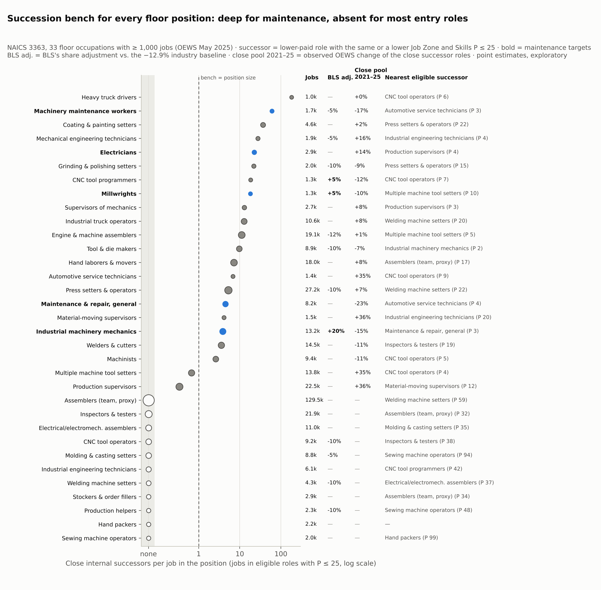

# Manufacturing Talent Supply Chain II-A
## Where Each Floor Job's Successors Come From — Job-Mix Change, Ageing and Worker Flows, and a Succession Map for Every Floor Job in Auto Parts Manufacturing (NAICS 3363)

<p align="center">
  <strong>How is the job mix on the auto-parts floor changing, who leaves first, and where can each floor job find its successors?</strong><br>
  <em>CES · OEWS May 2014, 2021–2025 · BLS Employment Projections 2025–35 and archived projections 2008–18 to 2014–24 · O*NET 31.0 · CPS 2020–2026 · exploratory and descriptive</em>
</p>


---

## 1. Motivation

This project began with the manufacturing workforce-ageing case of the 2023 Purdue HR Case Competition and continues the
earlier repository [*Manufacturing Talent Supply Chain at Risk (2010–2024)*](https://github.com/yechansota/Mfg_Talent_Supply_Chain.2010-2024.).
Part II has two repositories.

| Repository | Question | Design |
|---|---|---|
| **II-A (this repository)** | How is the floor job mix changing, who leaves first and where do production workers go (Part 1); where do each floor job's successors come from (Part 2) | exploratory, descriptive |
| [II-B: From the Production Line to Maintenance] | The one move that Parts 1 and 2 point to, production → equipment maintenance, tested in depth | pre-registered |

**Who the evidence is for.** Practitioners who design succession plans, redeployment and skill programmes on a floor
whose job mix is changing, and the managers who approve them. They need three things: which jobs have actually grown and
shrunk, who leaves first and by when a successor must be ready, and where the next person for each job can come from.
This repository shows these with public data.

**Ageing is read as replacement need and lead time, not as "shortage".** Demographic change has not historically mapped
consistently onto labour-market conditions, and projections of future skill demand have been judged not reliable enough
to guide skill-development policy (Freeman, 2006). This repository therefore does not use ageing as evidence of a labour
shortage. It reads ageing as which jobs face replacement need first because of their age structure, and how long it takes
to prepare a successor (3.4).

**Scope.** Auto parts manufacturing (NAICS 3363) is the depth case. In the BLS 2025–35 projections its jobs fall 13.9%
while manufacturing as a whole grows 0.6%, so the question "how should a projected decline be used for redeployment" is
sharpest here. Ageing and worker flows use the CPS for manufacturing as a whole, because NAICS 3363 cannot be isolated in
the CPS.

> **Problem statement.** The earlier repository concluded that a lack of binding mentoring cannot be shown with the
> industry-level data it used and that occupation-level (SOC) data are needed. The labour economics literature makes the
> same point: shortages are defined and measured by occupation (Barnow, Trutko & Schede Piatak, 2013), evidence of an
> economy-wide U.S. skill shortage is weak (Cappelli, 2015), and hiring difficulty in manufacturing is concentrated in some
> plants and specific skill demands rather than across the sector (Weaver & Osterman, 2017). II-A is that occupation-level
> step.

**Data.** Every input is a federal public statistic with documented methods. The pipeline re-runs from the raw files and
recomputes every reported number by a separate code path. Data and reproduction are in section 5.

### Questions this document answers
| # | Part | Question | Short answer | Section |
|---|---|---|---|---|
| Q1 | 1 | How has the floor job mix actually changed, and what does BLS expect? | Observed: industry employment is 12.5% below its 2018 peak; inside the industry, industrial machinery mechanics grew (+12.2%) and machinery maintenance workers fell by more than half (OEWS May 2021–2025). BLS projects the same direction. CNC tool operators, however, are cut by BLS but grew 35.5% in observed employment | 3.1, 3.2 |
| Q2 | 1 | How well have BLS projections done for this industry, and what can they be used for? | All four checkable vintages projected less than occurred, and the direction was wrong in three of four. Do not use them for the industry's level; use them for the current job mix, the direction of large occupation groups, and a list of hypotheses to check in the plant (the reasons BLS gives for its changes) | 3.1 |
| Q3 | 1 | Inside maintenance, is it headcount or skill that is changing? | Both. The growing mechanic job requires more systems evaluation, troubleshooting and control-software skill, but its pay edge has narrowed | 3.3 |
| Q4 | 1 | Who leaves first, and where do production workers go? (manufacturing as a whole) | Maintenance (28.6%) and machinists (31.8%) have the highest shares aged 55+ (all production 24.4%). Each month 0.10% of production workers move into maintenance in manufacturing and 0.44% retire. Inflow into manufacturing maintenance from production is about twice the outflow to retirement | 3.4 |
| Q5 | 2 | Where do each floor job's successors come from? | Maintenance jobs have a deep internal bench, but its sources are shrinking. Eleven mostly entry-level jobs (4–17 under other successor rules) have no close internal successor, and production supervisors have the thinnest bench. CNC tool operators are a close source for 13 jobs but have no successor of their own | 3.5 |

Each result is tagged with the kind of evidence behind it. **[Observed]** actual employment and moves measured by a
survey · **[Projected]** BLS projections and the reasons BLS gives (judgements) · **[Exploratory]** maps and patterns
computed with rules set in this repository. This repository has no pre-registered hypothesis.

---

## 2. Key findings

1. **[Observed] The industry shrank, and the mix inside maintenance changed** (Figures 1, 4). Annual average employment fell
   12.5%, from 599.7k in 2018 to 524.7k in 2025 (CES). In OEWS May 2021–2025, industrial machinery mechanics inside the
   industry grew 12.2% and machinery maintenance workers fell 52.7%; the maintenance family of five jobs fell 6.2%.
2. **[Projected] BLS projects the same direction, but its level for this industry is hard to trust** (Figures 2, 3). BLS
   projects a further fall in jobs to 2035 (−13.9%) driven by falling output (−24.6%), not by rising output per worker.
   Every occupation BLS does not adjust moves by −12.9%; on top of that BLS raises industrial machinery mechanics by +20%
   relative to this baseline and cuts CNC tool operators, press setters and welding machine setters by −10%. But BLS's past
   projections for this industry were below the outcome in all four checkable vintages (−6.7% to −26.1%), and the direction
   was wrong in three of four. CNC tool operators, cut by BLS, grew 35.5% in observed employment in May 2021–2025.
3. **[Observed] The maintenance job that is growing is the more skilled one, but its pay edge has narrowed** (Figure 4).
   After FDR correction, O*NET rates mechanics above machinery maintenance workers on 14 of 65 skill and knowledge elements
   (systems evaluation, troubleshooting, installation and others) and lists control software (PLC, SCADA) for mechanics
   only. Yet the mechanics' pay edge over general maintenance workers narrowed from 19% to 4%.
4. **[Observed · Exploratory] Maintenance, and machinists — one of the production jobs closest to maintenance — are the
   oldest on the floor** (Figure 5; manufacturing as a whole). The share aged 55+ is 28.6% in maintenance and 31.8% among
   machinists, above all production (24.4%), all of manufacturing (25.6%) and all employed workers (23.5%), with no clear
   trend in 2020–2026. Each month 0.10% of production workers in manufacturing move into maintenance in manufacturing and
   0.44% retire (1.57% at 55+). Inflow into manufacturing maintenance from production is about twice the outflow to
   retirement (2.1, 95% interval 1.4–3.4), while all inflow and all outflow are nearly equal (0.91, 0.80–1.04).
5. **[Exploratory] Floor succession splits three ways, and one job is the source for many** (Figure 6). Among 33 floor jobs
   (72% of the industry's jobs), maintenance jobs have a deep internal bench, but most of it is shrinking. Eleven jobs,
   mostly entry level (52% of the mapped jobs), have no close internal successor (4–17 under other reasonable rules). Among
   skilled jobs with at least one close successor, production supervisors have the thinnest bench. CNC tool operators are
   a close successor source for 13 jobs, including all five maintenance targets, but no job is close enough to succeed
   them.

> **What this means in practice — what managers can prepare.**
> 1. *Redeploy on observation, not projection.* CNC tool operators, cut by BLS, actually grew. Treat projected declines as
>    a scenario and start redeployment when the plant's own headcount trend confirms it.
> 2. *Prepare successors early, starting with the oldest jobs.* Maintenance and machinists have the highest shares aged
>    55+, and 40.6% of maintenance incumbents report more than a year of on-the-job training (II-B). Name successors at
>    least one to two years before the expected retirement.
> 3. *Production is already the largest source of maintenance workers.* Do not leave that flow to chance; build it into a
>    recruiting, training and certification path (II-B).
> 4. *Moving one job opens another.* For a job that is the source for many jobs, such as CNC tool operators, plan the
>    backfill at the same time.
> 5. *Fill entry jobs by hiring, and build a deliberate path to production supervisor.* Internal promotion alone does not
>    supply them.

### Figure guide
| Figure | What it shows | Section |
|---|---|---|
| 1 | Industry jobs, observed 2016–2026 and BLS projection to 2035 | 3.1 |
| 2 | Past BLS projections for auto parts against what happened | 3.1 |
| 3 | BLS 2025–35 projection by occupation: industry shrink + BLS's own adjustment | 3.2 |
| 4 | Which maintenance jobs grew and how the mechanics' pay edge changed, 2021–2025 | 3.3 |
| 5 | Who is oldest, where production workers go, inflow vs retirement in maintenance | 3.4 |
| 6 | Succession bench for every floor job | 3.5 |

---

## 3. Detailed analysis and figures

> **How to read.** In Part 2 the *directional deficit $D$* adds up, element by element, how far a source job *falls
> short* of a target job, weighted by the element's importance in the target job; the *proximity percentile $P$* is the
> share of all other occupations that fall short by no more than the source job (**lower = closer**). Definitions and
> formulas are in section 5.

### Part 1: How the floor job mix is changing

#### 3.1 Industry employment: observed, projected by BLS, and the track record of those projections



*How to read:* the blue line with dots is the annual average number of jobs; the thin grey line is the monthly series; the open circle is the 2026 average of the months published so far. The dashed line from 2025 to 2035 is the BLS projection, not an observation. Compare the slope of the dashed line with the blue line: the industry has already been falling since 2023.

*The shaded band (March 2020 – December 2021) marks the pandemic period to help read the figure. It is a display window
chosen for this figure, not an official BLS period, and is used in no estimate.*

**[Observed] Industry employment** (BLS CES). Annual average employment in this industry was 599.7k in 2018, the highest
of 2008–2025. It fell to 530.3k in 2020, recovered to 563.8k in 2023, and was 550.8k in 2024 and 524.7k in 2025, 12.5%
below 2018. The January–August 2026 average is 514.1k, 2.6% below the same months of 2025 (recent months may be
revised). From 2023 to 2025 employment fell by about 3.5% a year.

**[Projected] The BLS scenario.** BLS projects 451.5k in 2035, about −1.5% a year. BLS first projects industry output
with a macroeconomic model, then industry employment from output, relative wages and technology trends, and then the
occupations inside each industry ([BLS Handbook of Methods, EP calculation](https://www.bls.gov/opub/hom/emp/calculation.htm)).
In the BLS industry tables, auto parts moves differently from the rest of the motor vehicle industry (Table 2.11).

| Industry (BLS EP, 2025 → 2035) | Jobs | Real output (chained 2017 dollars) | Output per job |
|---|---|---|---|
| **Motor vehicle parts (3363)** | 524.7k → 451.5k (**−13.9%**) | \$246.7 bn → \$186.0 bn (**−24.6%**) | **−12.4%** |
| Motor vehicles (3361) | 285.8k → 306.0k (+7.1%) | \$362.0 bn → \$456.4 bn (+26.1%) | +17.8% |
| Bodies and trailers (3362) | 156.6k → 162.0k (+3.5%) | \$49.7 bn → \$66.7 bn (+34.2%) | +29.7% |
| All manufacturing | 12,634k → 12,706k (+0.6%) | +16.3% | +15.6% |
| All industries | 170.3 million → 176.2 million (+3.5%) | +22.0% | +17.9% |

*Definition.* **Real output** is the industry's production valued in chained 2017 dollars, so price changes are removed.
With real output $O_t$ and employment $E_t$ in year $t$ and 2025–35 growth rates $g_O$ and $g_E$,

$$\Delta_{\text{output per job}} = \frac{O_{2035}/E_{2035}}{O_{2025}/E_{2025}} - 1 = \frac{1 + g_O}{1 + g_E} - 1
= \frac{1 - 0.246}{1 - 0.139} - 1 = -12.4\% .$$

So in the BLS numbers the job loss in this industry comes from falling output, not from rising output per worker, and it
happens while vehicle production grows. Of the 125 industries with output in Table 2.11, only four see output per job
fall, and auto parts falls the most. BLS does not say why parts output falls. Table 1.12 has five rows specific to auto
parts; the only one that names a reason on the demand side for parts is for engine assemblers (fewer internal combustion
engines as electric-vehicle production grows).

**The industry baseline.** Inside the industry, 95 of the 181 occupations in the National Employment Matrix (339.6k of
522.8k jobs, 65%) are projected at exactly **−12.9%**. These are the occupations BLS did not adjust: when BLS changes the
shares of some occupations, the rest are rescaled together and move with the industry (Handbook of Methods). Every one of
the 86 occupations off the baseline has a Table 1.12 factor for auto parts or for all industries, and none of the 95 on
it does. Section 3.2 carries this two-stage reading into the job mix.

**How well have these projections done for this industry?** (DL-38, DL-40, DL-41.)



*How to read:* each row is one archived BLS projection. The open circle is the 10-year change BLS projected; the blue dot is what actually happened (CES). The grey bar between them is the miss. In all four checkable rows the blue dot sits to the right of the open circle, so actual employment beat the projection every time. The bottom row (2025–35) has no outcome yet.

| Vintage | Base-year value: BLS matrix / CES | Projected change | Actual change (CES) | Target-year error (projected / actual − 1) | Direction |
|---|---|---|---|---|---|
| 2008–18 | 544.4k / 543.7k | −18.6% | +10.3% | **−26.1%** | wrong |
| 2010–20 | 415.1k / 418.9k | −4.9% | +26.6% | **−25.5%** | wrong |
| 2012–22 | 479.6k / 482.8k | +5.8% | +14.3% | **−8.0%** | right |
| 2014–24 | 536.6k / 537.0k | −4.2% | +2.6% | **−6.7%** | wrong |

*The 2010–20 target year 2020 is the pandemic year (flagged, not excluded).*

All four vintages projected less than occurred, and the direction was wrong in three. The base-year values agree with the
CES annual averages within 1%, so a difference in definitions does not explain this. The gap was largest in the two
vintages based in 2008 and 2010 (−26%; the 2010 base sits near the industry's employment low) and −7% to −8% in the two
recent ones. BLS does not project business cycles, so this record of four vintages is not generalized to "BLS always
projects this industry too low", and it does not say which way the 2035 projection will miss. The same comparison was
run for occupations in 2014–24, but over that period OEWS changed its occupation classification (hybrid 2010/2018 SOC
codes in 2019 and 2020) and its estimation method (MB3 from 2021), so observed differences mix in measurement changes;
it is not used to judge the accuracy of BLS occupational projections (DL-41; `outputs/track_record/`).

**So what is BLS data good for?** BLS evaluates its own projections afterwards. For 2014–24 it got the direction of major
industry sectors right 69% of the time ([industry projections evaluation](https://www.bls.gov/emp/evaluations/2014-2024-industry.htm)),
the direction of occupation groups right 86% of the time, and its share error for production occupations was smaller
than that of a naive model (0.29 vs 0.84) ([occupational projections evaluation](https://www.bls.gov/emp/evaluations/2014-2024-occupational.htm)).
In the 1988–2000 evaluation, the error for 54% of occupations came mainly from judgements about staffing patterns
within industries (Alpert & Auyer, 2003).

| BLS data | Evidence | Use in this repository |
|---|---|---|
| Current job mix (within-industry shares in the matrix) | shares of 181 occupations inside 3363 correlate 0.9999 with OEWS | used as is |
| Direction of large occupation groups | 86% right for 2014–24 groups; production share error below a naive model | used as a scenario |
| Occupation adjustments and their reasons (Table 1.12) | published reasons, but judgements, not measurements; the main source of occupational projection error | a list of hypotheses to check in the plant |
| Direction inside maintenance (mechanics ↑, machinery maintenance workers ↓) | agrees with the observed OEWS 2021–25 direction (3.3) | shown where it agrees with observation |
| Level for industry 3363 | all four vintages too low; direction wrong in three of four | not used as a level |
| Level for detailed occupations | CNC tool operators: −10% against the BLS baseline, observed +35.5% | cross-checked against observation |

**What happens when projections are used as forecasts.** BLS states that its projections are not forecasts, that they
assume full employment, and that they do not project business cycles
([Handbook of Methods, concepts](https://www.bls.gov/opub/hom/emp/concepts.htm)). Policy documents have nonetheless used
them as evidence of shortages. Claims of a STEM workforce shortage cited BLS projections, but BLS projections assume a
labour market in which supply meets demand and so do not predict shortages; projections for computer occupations were
more than three times too high for 2000–2010 and more than two times too low for 2010–2020 (Hira, 2022). On claims that
baby-boom retirements will create large labour shortages, see Freeman (2006) above. National occupational projections
used by local workforce agencies correlated 0.23 with actual growth, with a mean absolute error of 28.2 percentage points,
in a sample of 647 occupations in 36 states, and the authors recommend checking with state labour-market information
agencies and local employers (Fee & Dunne, 2026). No case was found of an individual manufacturer's decision going wrong
because of a BLS projection error.

#### 3.2 Job mix: observed change and the BLS adjustments



*How to read:* each bar is one occupation's projected 2025–35 change inside auto parts. The grey part (to the dashed line at −12.9%) is the industry-wide shrink every occupation shares; the coloured part is BLS's own adjustment for that occupation (blue = maintenance, dark grey = production). A bar ending left of the dashed line was cut by BLS; right of it, raised. The diamond is the same occupation across all industries. The right-hand columns give the total change, the BLS adjustment and the reason BLS states (Table 1.12).

The BLS adjustment compares each occupation's change with the baseline: $(1 + \text{change}) / (1 - 0.129) - 1$. The
right-hand column is the observed change of the same occupation.

| Occupation | Inside NAICS 3363, 2025 → 2035 (k) | Projected change inside 3363 | BLS adjustment vs baseline | BLS factor (Table 1.12) | Observed, OEWS May 2021–2025 |
|---|---|---|---|---|---|
| Industrial machinery mechanics | 12.9 → 13.4 | **+4.5%** | **+20%** | demand ↑ — automation in manufacturing (auto parts row) | +12.2% |
| Millwrights | 1.3 → 1.2 | −8.6% | +5% | demand ↑ — automation in manufacturing (auto parts row) | −14.6% |
| Maintenance and repair workers, general | 8.0 → 6.9 | −12.9% | — | none | −0.6% |
| Electricians | 2.8 → 2.5 | −12.9% | — | none for auto parts; data-centre demand in four construction industries | −27.0% |
| Maintenance workers, machinery | 1.6 → 1.4 | −17.3% | −5% | substitution — work shifts to industrial machinery mechanics (all industries) | −52.7% |
| CNC tool programmers (context) | 1.2 → 1.1 | −8.6% | +5% | demand ↑ — more CNC, automated and programmable machines (all industries) | +63.6% |
| Multiple machine tool setters | 13.4 → 11.7 | −12.9% | — | none | −28.9% |
| Machinists | 9.1 → 7.9 | −12.9% | — | none | −40.6% |
| Assemblers (team, proxy) | 126.0 → 109.7 | −12.9% | — | none | +8.0% |
| **CNC tool operators** | 9.0 → 7.0 | −21.6% | **−10%** | productivity ↓ — programmers control more machines at once (all industries) | **+35.5%** |
| Press setters and operators | 26.5 → 20.8 | −21.6% | −10% | productivity ↓ — CNC, automated and programmable machines (all industries) | −17.0% |
| Welding machine setters | 4.2 → 3.3 | −21.6% | −10% | productivity ↓ — robots and CNC replace less advanced machines (all industries) | +1.2% |
| Engine and other machine assemblers | 18.6 → 14.2 | −23.4% | −12% | productivity and demand ↓ — collaborative robots; fewer combustion engines as EVs grow (auto parts row) | −26.9% |
| **Industry total (NAICS 336300)** | 524.7 → 451.5 | −13.9% | | | +0.2% (CES −3.2%) |

The observed column is the difference between two OEWS estimates. Small changes (welding machine setters +1.2%, general
maintenance workers −0.6% and others) may be within sampling error, and small jobs move by large percentages (CNC tool
programmers 770 → 1,260). The projection covers 2025–35 and the observation 2021–25, so compare directions only.

**Industrial machinery mechanics (49-9041) — projection and observation agree.** BLS raises the share by 20% against the
baseline, turning the industry's decline into a 4.5% increase. It is the only one of the five maintenance targets
projected to grow. BLS's reason (Table 1.12, NAICS 336300 row): *"Demand change - share increases as automation in
manufacturing will increase demand for these workers."* Observed employment also grew 12.2% in May 2021–2025.

**CNC tool operators — projection and observation disagree.** BLS cuts the share 10% against the baseline because
programmers control more machines at once, but observed employment grew 35.5% (14.0% from May 2022). CNC machining appears
to have taken the place of the shrinking conventional machinists (−40.6%) and multiple machine tool setters (−28.9%), a
shift BLS itself expects. Treating this job as a redeployment target on the strength of its projected decline could have
opened gaps in a job that in fact grew.

**What the BLS reasons are.** Table 1.12 records judgements, not measurements. BLS economists review qualitative material
such as articles and expert interviews and quantitative material such as historical data and outside projections, judge
structural change, and turn it into changes in each occupation's share of the industry
([Handbook of Methods](https://www.bls.gov/opub/hom/emp/calculation.htm)). Of the 86 occupations BLS adjusts in this
industry, 42 (5 raised, 37 cut; 49.8% of the adjusted jobs) cite robots or automation in their reason (DL-39). Across all
industries, the only floor occupations whose share BLS raises because of automation are industrial machinery mechanics,
millwrights and CNC tool programmers. In BLS's view, then, the demand created by automation goes to the jobs that maintain
and program the machines. This project does not measure automation in plants and does not estimate causal effects. As
outside evidence, robot exposure lowered employment and wages in U.S. local labour markets (Acemoglu & Restrepo, 2020),
and firms that adopted automation technologies reported higher skill requirements (Acemoglu et al., 2022).

**Why the matrix total (524.7k) differs from OEWS (538,980).** BLS builds the matrix from CES industry employment, OEWS
staffing patterns and CPS self-employment, so its industry total equals the CES annual average and is a different
estimate from the OEWS survey total. The job mix is the same (share correlation 0.9999, largest difference about 0.05
points). Levels (jobs, wages, weights) therefore come from OEWS, and the matrix is used only for shares and rates of
change.

#### 3.3 Inside maintenance: skill, not only headcount [Observed]



*How to read:* left panel — jobs in each maintenance occupation, indexed to May 2021 = 100; the blue line (industrial machinery mechanics) rises while the black line (the five jobs together) falls, and the label at each line end is the 2021→2025 change. Right panel — how much more the mechanics earn per hour than each other maintenance job; open circle = May 2021, blue dot = May 2025. Every arrow points left: the mechanics' relative pay fell against all four.

**Headcount.** In OEWS May 2021–2025 the maintenance family in 3363 fell 6.2% (29,130 → 27,330) while industrial machinery
mechanics grew 12.2% (11,770 → 13,210; from 40.4% to 48.3% of the family). Machinery maintenance workers fell 52.7%
(3,570 → 1,690), electricians 27.0% and millwrights 14.6%; general maintenance workers did not change (−0.6%, within
sampling error). The other changes each exceed four times their approximate standard error. Each May estimate pools six
semiannual panels over three years and May 2021 and May 2025 share no panel, so treating the two estimates as independent
is reasonable ([OEWS technical notes](https://www.bls.gov/oes/2025/may/oes_tec.htm)). Counting from May 2022 gives the
same directions (mechanics +10.9%, machinery maintenance workers −49.4%, family −4.8%).

**Skill content.** Of the 65 Skills and Knowledge elements with published standard errors, industrial machinery mechanics
are rated higher than machinery maintenance workers on 17 (z > 1.96) and lower on 1 (law and government). Correcting for
the 65 tests leaves 14 higher and 1 lower at Benjamini–Hochberg 5%, and 8 higher and 0 lower under Bonferroni. The largest
differences are systems evaluation, active learning, learning strategies, operation and control, instructing, systems
analysis, troubleshooting and installation. O*NET lists four industrial control software examples (PLC, SCADA) for
mechanics only. The elements are correlated and the two occupations were rated in different years (2021, 2024), so these
counts describe a pattern rather than independent tests.

**Pay.** On mean hourly wages, which carry published standard errors, the mechanics' edge narrowed from +19% to +4% over
general maintenance workers and from +14% to +8% over machinery maintenance workers, and their gap to millwrights and
electricians widened from about −19% to −22% / −23%. The narrowing against machinery maintenance workers happened between
May 2021 and May 2022, with no change in 2022–2025 (change in the log wage ratio z = −0.2). The other changes hold from
either start year (|z| ≥ 5.0).

**One alternative explanation.** The fall in machinery maintenance workers (−1,880) and the rise in mechanics (+1,440)
nearly offset, so the data also fit employers retitling jobs at similar pay, besides the substitution BLS describes. Public
data cannot separate the two; plant job descriptions and pay grades can. (For reference: across the industry, BLS tends to
raise occupations that need more preparation and cut those that need less (Spearman ρ = 0.42 with the Job Zone). This is
a projection, not an observation, so it is kept in the Technical Documentation only.)

> **What this means for succession planning.** The growing maintenance job requires more systems, troubleshooting and
> control-software skill than the shrinking one, but in this industry it no longer pays much more. And the close successor
> sources of industrial machinery mechanics (3.5) fell 15% in May 2021–2025. A skill programme has to build skills that pay
> does not strongly reward, from shrinking sources, so the pay ladder needs checking at the same time.

#### 3.4 Who leaves first, and where production workers go [Observed · Exploratory, manufacturing as a whole] (DL-44)



*How to read:* left — share of workers aged 55+ in each job group with its 95% interval; the dotted line is all employed workers, and the blue rows (maintenance, machinists) sit furthest right, i.e. oldest. Middle — where production workers in manufacturing are one month later, leaving out the 91% who stay in the same job; the blue bar is the move into maintenance, small next to other jobs, unemployment and retirement. Right — per 100 maintenance workers a month, by age: blue = arriving from production, grey = leaving to retirement; the box gives the all-age ratio.

**How it was measured.** The CPS (Current Population Survey) interviews a household in consecutive months, so the same
person can be followed across two consecutive months. From 80 months of microdata, January 2020 – September 2026, the
pipeline reads 6,539,550 records of civilians aged 16+ and forms 4,326,472 consecutive-month pairs with the keys of the
Census linking guide and consistency checks on month in sample, sex and age (link rate 88.5–90.2% by year). Definitions,
age bands and categories were recorded before computing (DL-44). For flows the headline excludes pairs with an imputed
occupation, industry or labour-force status, and all pairs are shown beside it. Intervals come from a household bootstrap
(B = 1,000) and the NCHS standards for proportions are applied. The figures are for manufacturing as a whole, not 3363
alone.

**Who is oldest (employed in manufacturing, monthly records pooled over 2020–2026).**
| Job group | Share aged 55+ [95%] | Records |
|---|---|---|
| **Machinists** | **31.8%** [29.1, 34.4] | 6,712 |
| **Maintenance (five target jobs)** | **28.6%** [26.8, 30.4] | 12,843 |
| Multiple machine tool setters + other metal and plastic workers | 25.7% [23.6, 27.9] | 7,410 |
| CNC tool operators + programmers | 24.0% [19.5, 28.5] | 1,794 |
| Other production | 23.9% [23.3, 24.5] | 112,171 |
| All production | 24.4% [23.9, 25.0] | 128,087 |
| All of manufacturing | 25.6% [25.3, 26.0] | 349,998 |
| All employed, every industry | 23.5% [23.3, 23.6] | 3,765,898 |

By year, the share aged 55+ moves within 27.1–30.6% for maintenance and 23.7–25.2% for production, with overlapping
intervals, so no clear ageing trend is visible in 2020–2026. The issue is the *distribution*, not a trend: the destination
of the production → maintenance path (maintenance) and machinists — the close source with its own code — are the oldest
on the floor. The mixed codes that hold the other two close feeders (CNC tool operators + programmers 24.0%, multiple
machine tool setters + other metal and plastic workers 25.7%) are close to the production average.

**Where production workers are a month later (production workers in manufacturing, n = 80,890).**
| Status next month | All ages | Aged 55+ |
|---|---|---|
| Same occupation (manufacturing) | 90.98% | — |
| Other production job (manufacturing) | 2.13% | 1.80% |
| **Maintenance (manufacturing)** | **0.10%** | 0.09% |
| Other occupation (manufacturing) | 1.35% | — |
| Maintenance (other industry) | 0.04% | — |
| Other occupation (other industry) | 1.82% | 1.32% |
| Unemployed | 1.34% | 1.00% |
| **Retired** | **0.44%** | **1.57%** |
| Not working because of a disability | 0.25% | — |
| Other not in the labour force | 1.55% | — |

The move from production into maintenance is one small path among the many by which production workers leave. In the same
month far more go to other jobs outside manufacturing (1.82%) or retire (0.44%).

**How fast workers enter and leave maintenance (maintenance in manufacturing, per 100 workers a month).**
| Flow | All ages | 16–34 | 35–54 | 55+ |
|---|---|---|---|---|
| In from production | 1.07 | 1.40 | 1.01 | 0.85 |
| In from outside the labour force | 1.02 | 1.25 | 0.66 | 1.35 |
| Out to retirement | 0.50 | 0.05 | 0.09 | 1.50 |
| Out to production | 1.13 | 1.34 | 1.12 | 0.95 |

Inflow from production is 2.1 times the outflow to retirement (1.4–3.4; 1.7, 1.0–3.0, excluding 2020–2021). But all
inflow and all outflow are nearly equal (0.91, 0.80–1.04). Production supplies enough entrants to fill the places that
retirement opens, but maintenance workers also leave for other occupations and industries on a similar scale, and the flow
back to production is similar to the flow in. Similar flows in both directions between production and maintenance can
come from occupation-coding error as well as from real moves.

**Reading these flows.** Monthly flows are large in both directions. Among maintenance workers aged 55+, the outflow to
retirement (1.50) is close to the inflow from outside the labour force (1.35), which mixes returns from retirement and
reporting error (Poterba & Summers, 1986). These flows are therefore not turned into annual retirement counts; they are
used only to compare two flows within the same pairs. The CPS samples housing units, so people who move are not linked
(Census linking guide).

> **What this means for succession planning.** The highest retirement exposure sits in maintenance and in one of its close
> sources (machinists), so retirements in one job can shrink another job's successor source at the same time. The
> production → maintenance flow exceeds the outflow to retirement, but it does not stay on its own: the flow out of
> maintenance is about as large, so retention (pay ladder, career path) needs managing as much as development.

### Part 2: Where every floor job's successors come from

#### 3.5 Who can succeed whom [Exploratory] (DL-31 – DL-33)



*How to read:* each row is one floor job (bold = maintenance targets), sorted from the deepest to the thinnest bench. The dot shows how many jobs in close successor occupations exist per job held (log scale; right of the dashed line at 1 = more successors than positions; 'none' = no close successor). Dot size = size of the job; blue = maintenance. The columns give the job's size, BLS's adjustment, the observed 2021–25 change of its close successor sources (negative = the bench is shrinking) and the nearest eligible successor with its proximity P.

**Scope.** Every detailed floor occupation (SOC 51, 49, 53, 47, 17-3) with at least 1,000 jobs in NAICS 3363: 34 jobs, of
which 33 have an O*NET Skills profile (387,910 jobs, 72% of the industry; "production workers, all other" has none). For
each job T and every other job S, the directional deficit $D(S \to T)$ and the percentile $P$ are computed with T's own
importance weights.

**Why a successor rule is needed.** $D$ counts only what the source lacks, so more skilled jobs always look close. Without
a rule, for 31 of the 33 jobs the nearest "successor" would be a job that already earns more (supervisors, electricians,
technicians), which is not a succession move. An **eligible successor** therefore earns less inside the industry (OEWS May
2025 median wage) and needs no more preparation (O*NET Job Zone): a promotion or a lateral move. A **close** successor also
has $P \le 25$. **Bench ratio** = jobs in close successor occupations per job in the position. **Stability** = share of
400 half-sets (random halves of the Skills elements) in which the pair stays at $P \le 25$.

| Job | SOC | Jobs (May 2025) | BLS adjustment vs the −12.9% baseline | Close successor jobs (number, jobs) | Bench ratio | Nearest eligible successor (P, stability) | Close successor sources, observed 2021–25 |
|---|---|---|---|---|---|---|---|
| Heavy truck drivers | 53-3032 | 1,020 | — | 5 (183,960) | 180.4 | CNC tool operators (P 6, 98%) | +0% |
| **Maintenance workers, machinery** | 49-9043 | 1,690 | −5% | 12 (102,050) | 60.4 | Automotive service technicians (P 3, 100%) | −17% |
| Coating and painting setters | 51-9124 | 4,640 | — | 4 (169,730) | 36.6 | Press setters and operators (P 22, 66%) | +2% |
| Mechanical engineering technicians | 17-3027 | 1,890 | −5% | 5 (52,300) | 27.7 | Industrial engineering technicians (P 4, 100%) | +16% |
| **Electricians** | 47-2111 | 2,920 | — | 9 (65,210) | 22.3 | Production supervisors (P 4, 100%) | +14% |
| Grinding and polishing setters | 51-4033 | 2,050 | −10% | 4 (44,910) | 21.9 | Press setters and operators (P 15, 89%) | −9% |
| CNC tool programmers | 51-9162 | 1,260 | +5% | 2 (23,010) | 18.3 | CNC tool operators (P 7, 98%) | −12% |
| **Millwrights** | 49-9044 | 1,340 | +5% | 3 (24,270) | 18.1 | Multiple machine tool setters (P 10, 94%) | −10% |
| Supervisors of mechanics | 49-1011 | 2,700 | — | 5 (34,940) | 12.9 | Production supervisors (P 3, 100%) | +8% |
| Industrial truck operators | 53-7051 | 10,570 | — | 2 (133,730) | 12.7 | Welding machine setters (P 20, 79%) | +8% |
| Engine and other machine assemblers | 51-2031 | 19,090 | −12% | 8 (212,670) | 11.1 | Multiple machine tool setters (P 5, 100%) | +1% |
| Tool and die makers | 51-4111 | 8,930 | −10% | 10 (86,680) | 9.7 | Industrial machinery mechanics (P 2, 100%) | −7% |
| Hand laborers and material movers | 53-7062 | 18,040 | — | 1 (129,460) | 7.2 | Assemblers (team, proxy) (P 17, 81%) | +8% |
| Automotive service technicians | 49-3023 | 1,350 | — | 1 (9,200) | 6.8 | CNC tool operators (P 9, 96%) | +35% |
| Press setters and operators | 51-4031 | 27,220 | −10% | 3 (142,510) | 5.2 | Welding machine setters (P 22, 79%) | +7% |
| **Maintenance and repair workers, general** | 49-9071 | 8,170 | — | 6 (36,670) | 4.5 | Automotive service technicians (P 4, 98%) | −23% |
| Material-moving supervisors | 53-1047 | 1,500 | — | 1 (6,130) | 4.1 | Industrial engineering technicians (P 20, 78%) | +36% |
| **Industrial machinery mechanics** | 49-9041 | 13,210 | +20% | 8 (50,970) | 3.9 | Maintenance and repair workers, general (P 3, 99%) | −15% |
| Welders and cutters | 51-4121 | 14,470 | — | 3 (51,190) | 3.5 | Inspectors and testers (P 19, 78%) | −11% |
| Machinists | 51-4041 | 9,360 | — | 3 (24,360) | 2.6 | CNC tool operators (P 5, 99%) | −11% |
| Multiple machine tool setters | 51-4081 | 13,810 | — | 1 (9,200) | 0.7 | CNC tool operators (P 4, 100%) | +35% |
| Production supervisors | 51-1011 | 22,500 | — | 2 (7,630) | 0.3 | Material-moving supervisors (P 12, 98%) | +36% |
| Assemblers (team, proxy) | 51-2090 | 129,460 | — | 0 (0) | none | Welding machine setters (P 59, 0%) | — |
| Inspectors and testers | 51-9061 | 21,920 | — | 0 (0) | none | Assemblers (team, proxy) (P 32, 16%) | — |
| Electrical and electromechanical assemblers | 51-2028 | 10,990 | — | 0 (0) | none | Molding and casting setters (P 35, 8%) | — |
| CNC tool operators | 51-9161 | 9,200 | −10% | 0 (0) | none | Inspectors and testers (P 38, 0%) | — |
| Molding and casting setters | 51-4072 | 8,780 | −5% | 0 (0) | none | Sewing machine operators (P 94, 0%) | — |
| Industrial engineering technicians | 17-3026 | 6,130 | — | 0 (0) | none | CNC tool programmers (P 42, 6%) | — |
| Welding machine setters | 51-4122 | 4,270 | −10% | 0 (0) | none | Electrical and electromechanical assemblers (P 37, 0%) | — |
| Stockers and order fillers | 53-7065 | 2,900 | — | 0 (0) | none | Assemblers (team, proxy) (P 34, 18%) | — |
| Helpers, production workers | 51-9198 | 2,270 | −10% | 0 (0) | none | Sewing machine operators (P 48, 0%) | — |
| Packers and packagers, hand | 53-7064 | 2,240 | — | 0 (0) | none | — | — |
| Sewing machine operators | 51-6031 | 2,020 | — | 0 (0) | none | Packers and packagers, hand (P 99, 0%) | — |

`outputs/floor_map/position_summary.csv` (per job), `succession_pairs.csv` (all 1,056 job pairs).

**What the map shows.**
- **Maintenance has a deep bench, but four of the five targets' benches are getting thinner.** Every maintenance target
  has more jobs in close internal successor occupations than jobs of its own (bench ratio 3.9–60). For industrial
  machinery mechanics, the only one BLS raises, the close sources are 8 occupations with 50,970 jobs, and general
  maintenance workers are the closest (P 3, stable in 99% of the half-sets). These source occupations had 15% fewer jobs in
  May 2025 than in May 2021 (9% fewer than in May 2022). Only electricians saw their close sources grow.
- **Eleven jobs (52% of the mapped jobs, 200,180) have no close internal successor.** Most are the lowest-paid entry jobs
  (team assemblers, inspectors, electrical assemblers, molding and welding machine setters, helpers, packers, stockers,
  sewing machine operators): few jobs can feed them by promotion, so outside hiring is the pipeline. Two are not entry
  jobs: CNC tool operators (15 eligible occupations, none closer than P 38) and industrial engineering technicians (24
  eligible occupations, none closer than P 42).
- **Among skilled jobs with at least one close successor, production supervisors have the thinnest bench (0.3).** Of the
  12 jobs in Job Zone 3 or above, only industrial engineering technicians (none) have less. The only close jobs are
  material-moving supervisors (P 12) and industrial engineering technicians; no production job is close. This is the
  Skills result; with Knowledge, team assemblers fall inside the threshold (P 22.9) and the ratio becomes 6.1 (DL-32).
- **One job is the source for many.** CNC tool operators are a close successor source for 13 jobs (11–13 when the ratings
  are redrawn): the five maintenance targets, machinists, multiple machine tool setters, engine assemblers, tool and die
  makers, CNC tool programmers, mechanical engineering technicians, automotive service technicians and truck drivers. For
  multiple machine tool setters and automotive service technicians they are the only close source. Yet no job is close
  enough to succeed CNC tool operators (nearest P 38). BLS cuts this job 10% against the industry baseline, but observed
  employment grew 35.5% in May 2021–2025.

> **Reading.** Floor succession splits three ways. Where an internal bench exists (maintenance, skilled setters,
> technicians), the task is to train before the sources shrink further. Entry jobs have no internal source, so hiring is
> the pipeline. Production supervisors have no close production job on Skills, so a path has to be built deliberately.

**How firm are these numbers? (DL-32).** The map was re-run with the Skills ratings redrawn from their published standard
errors (B = 200) and under six other successor rules.

| Rule | Jobs with no close successor | Their jobs | Thinnest maintenance bench | Production supervisors' bench |
|---|---|---|---|---|
| **Base:** earns less, Job Zone ≤ the job's, P ≤ 25 (Skills) | **11** | 200,180 | 3.9 | 0.3 |
| Same rule, ratings redrawn (median of 200 [95% range]) | 11 [10, 12] | — | 3.9 | 0.3 |
| Stricter closeness, P ≤ 15 | 17 | 276,620 | 3.9 | 0.3 |
| Looser closeness, P ≤ 35 | 9 | 175,360 | 9.1 | 0.3 |
| Wage rule only | 11 | 200,180 | 3.9 | 0.3 |
| Job Zone rule only (higher-paid jobs included) | 0 | 0 | 6.9 | 0.6 |
| Lateral moves allowed (below 110% of the job's wage) | 4 | 13,290 | 5.6 | 0.3 |
| Knowledge instead of Skills | 8 | 152,960 | 13.0 | 6.1 |

Rating error hardly moves the map: over 200 redraws the count stays at 10–12, and 75 of the 98 close pairs stay close in at
least 80% of the redraws. The rule matters more. The count moves from 0 when higher-paid jobs count as successors to 17 at
P ≤ 15, and allowing lateral moves up to 10% above the job's wage leaves 4 (industrial engineering technicians, sewing
machine operators, packers, stockers). "Eleven" is therefore the result of the base rule, not a fixed fact, while the
maintenance bench (≥ 3.9) holds under every rule tested. Four bench ratios rest on pairs near P = 25 and are better read as
their redraw ranges: coating and painting setters 36.6 (1.9–36.6), engine assemblers 11.1 (2.0–11.4), press setters 5.2
(0–5.2), welders 3.5 (0–13.2). `outputs/floor_map/rule_variants.csv`, `floor_bootstrap.csv`.

> **From II-A to II-B: why the production → maintenance move is tested separately.** Part 1 shows, in both observation and
> projection, that the most skilled maintenance job, industrial machinery mechanics, is growing while the industry shrinks
> (3.1–3.3), and that maintenance and one of its close sources (machinists) are the oldest on the floor (3.4). Part 2 shows
> that production jobs (SOC 51) hold 66% of the close successor jobs of industrial machinery mechanics, 92% for general
> maintenance workers, 98% for machinery maintenance workers, 100% for millwrights and 51% for electricians. But this
> proximity, computed from skill ratings, says workers *could move*, not that they *do*, and it is the same measure as
> II-B's pre-registered H1, so the two repositories do not confirm the same fact twice. Actual moves can only be checked with
> other data. [II-B](https://github.com/yechansota/Mfg_Talent_Supply_Chain_II.Line_to_Maintenance) therefore tests this
> one path separately, with a pre-registered design and observed CPS moves.

---

## 4. Considerations, constraints and recommendations

### 4.1 Recommendations for practitioners

*Part 1: job mix and ageing*

1. **Treat projected declines as scenarios; start redeployment from observation.** BLS's past projections for this
   industry were below the outcome all four times (3.1), and CNC tool operators, cut by BLS, actually grew (3.2). Choose
   redeployment targets from the plant's actual headcount trends, and use the reasons BLS gives as a list of hypotheses to
   check in the plant.
2. **Start succession one to two years ahead, beginning with the oldest jobs.** Maintenance and machinists have the
   highest shares aged 55+ (3.4). Successors should be named and training started at least one to two years before the
   expected retirement (40.6% of maintenance incumbents report more than a year of on-the-job training; II-B).
3. **Manage retention as much as development.** Flows into and out of maintenance in manufacturing are nearly equal (3.4).
   The mechanics' pay edge has narrowed (3.3), so compare the plant pay grades of mechanics, maintenance workers and the
   source jobs before relying on pay as the incentive.

*Part 2: succession for every floor job*

4. **Plan the backfill before moving CNC tool operators.** They are the close successor source for 13 floor jobs and the
   only one for multiple machine tool setters and automotive service technicians, and no internal job is close enough to
   replace them (3.5).
5. **Treat entry jobs as a hiring pipeline.** Entry jobs with no close internal successor, such as team assemblers,
   inspectors and electrical assemblers (11 under the base rule, 4–17 under others), are supplied by hiring and onboarding,
   not internal succession.
6. **Build a path to production supervisor.** On Skills no production job is close to supervisors (3.5), so promotion from
   the line alone will not supply them. Plan a deliberate path and check it against plant job descriptions.

### 4.2 Constraints and limitations
- **Occupations, not people.** O*NET ratings are occupation averages across all industries, and individuals differ. The
  succession map shows where successors *could* come from, not who actually moves, and must not be used to rank or select
  individuals ([29 CFR 1607.2(B)](https://www.law.cornell.edu/cfr/text/29/1607.2)).
- **Proximity is not movement.** Whether production → maintenance moves actually happen is checked by II-B with the CPS.
  Actual moves for other job pairs are outside the scope of this repository.
- **Industry scope.** Employment weights, wages and NEM projections are specific to NAICS 3363. KSA ratings and EP
  all-industry rates are economy-wide; CPS age profiles and flows are for manufacturing as a whole.
- **Nature of the CPS flows.** Monthly labour-force transitions include reporting error, and people who move are not
  linked. The flows are used only for comparisons within the same pairs and are not turned into annual counts (3.4).
- **Different employment estimates.** OEWS May 2025 (538,980) and the CES 2025 annual average (524.7k) come from different
  surveys and reference periods. Occupation levels come from OEWS only; CES is used only for the industry trend. Recent CES
  months may be revised.
- **OEWS comparisons over time.** OEWS pools three years of samples, so differences between years are read as observed
  differences, not trends.
- **Successor rule.** The wage and Job Zone rules approximate the plant's actual career ladders. Licensing (electricians),
  seniority and union rules are not in the model. The map uses Skills only; switching to Knowledge changes some conclusions
  (the production supervisors' bench) (3.5).
- **Exploratory analysis.** Every analysis in this repository is exploratory, not a hypothesis test. Definitions were
  recorded before computing, and anything changed after seeing results is recorded as such (`outputs/analysis_log.md`).

### 4.3 What was not covered, and what was tried without result
| Item | Result | Used instead |
|---|---|---|
| Actual moves between occupations (Census J2J) | J2J is tabulated only by industry, firm size/age, worker characteristics and geography; it has no occupation dimension ([J2J quickstart](https://lehd.ces.census.gov/doc/J2J_quickstart_guide.pdf)) | CPS monthly linked data (3.4, II-B) |
| Regional hiring pressure for maintenance workers (JOLTS) | state estimates exist only for total nonfarm ([BLS JOLTS state FAQ](https://www.bls.gov/jlt/jlt_statedata_faq.htm)) | national figures |
| Track record of BLS occupational projections (2014–24) | computed, but cannot judge accuracy because OEWS changed classification and method over the period (DL-41) | industry-level record (3.1) |
| CPS for 3363 alone | industry 3570 combines NAICS 3361–3363 and the sample is small | manufacturing as a whole |
| A multiplicative succession-risk index (proximity × employment) | no benchmark to validate weights or scale, and no units | interpretable measures shown side by side |
| A "shortage" frame | excess demand cannot be measured with these data | replacement need and lead time |
| Calling the successor pool "internal" | O*NET, OEWS and EP describe occupations in the labour market, not a company's workforce | "occupations adjacent in the labour market" |

### 4.4 Next steps
- **A map of actual moves.** Compare other job pairs in the Part 2 map with actual moves in the CPS monthly linked data
  (sample sizes need checking).
- **Manufacturing comparison.** Compare the 3363 job mix with all manufacturing (31–33) and with motor vehicles and bodies
  (3361, 3362) in OEWS May 2025.
- **Plant validation.** Check the successor rule against the plant's actual career ladders and job descriptions (subject
  to employer approval and an IRB determination).
- **Regional view.** Replace national weights with OEWS state × industry research estimates.
- **Updating the track record.** Add the 2016–26 projections in the same way once the 2026 CES annual average is out.

---

## 5. Data, methods and reproduction

**Why public data only.** Every input is a federal public statistic with documented methods. No employer or private data
are used, so anyone can download the same files and reproduce every number. Input files are recorded by SHA-256, the
pipeline re-runs end to end, and the output audit recomputes every reported number by a separate code path. Public data
do not remove error; they make it visible, so the published standard errors are carried with each estimate.

**Data.**
| Data | Version | Use |
|---|---|---|
| BLS Current Employment Statistics, CEU3133630001 | January 2008 – August 2026, not seasonally adjusted | observed industry employment (annual averages) |
| OEWS, NAICS 336300 | May 2014, May 2021–2025 | employment and wages by occupation inside the industry |
| BLS Employment Projections | 2025–35 | occupation projections and factors (Tables 1.10, 1.12); industry employment and real output (Tables 2.6, 2.8, 2.10, 2.11) |
| BLS National Employment Matrix, industry 336300 | 2025–35 | 2025 and 2035 employment by occupation inside the industry |
| BLS projections archive | 2008–18, 2010–20, 2012–22, 2014–24 | past projections against outcomes |
| BLS SOC 2010 → 2018 crosswalk | 2018 SOC | 2014–24 occupation comparison |
| O*NET Skills (10 essential + 25 transferable), Knowledge (33), Job Zones, Software Skills, Task Statements | 31.0 | distance between jobs, preparation level, skill content of maintenance jobs |
| BLS O*NET-SOC ↔ NEM crosswalk | as of 2026-08-27 | linking O*NET, EP and OEWS codes |
| CPS basic monthly public-use microdata (Census) | January 2020 – September 2026 (October 2025 not collected) | age profile; status of the same person in consecutive months |
| Census 2018 occupation code list; 2017 and 2022 industry code lists | — | linking CPS codes to SOC and NAICS |

**Maintenance family.** The same five jobs as II-B's pre-registered rule: equipment maintenance, repair and electrical
occupations with at least 1,000 jobs and an employment relative standard error of at most 10% in OEWS May 2025, NAICS
336300 — industrial machinery mechanics (13,210), maintenance and repair workers, general (8,170), electricians (2,920),
maintenance workers, machinery (1,690) and millwrights (1,340). First-line supervisors of mechanics, installers and
repairers (49-1011, 2,700 jobs) meet the size and precision thresholds but are not a pre-registered target of II-B. The
registration records no reason, and none is constructed afterwards (see II-B's sensitivity analysis). In this
repository's succession map they are included as an ordinary job. In the CPS the five 2018 Census codes that contain the
same jobs (6355, 7330, 7340, 7350, 7360) are used.

**Distance.** For each element $k$, with the Level score $z$ standardized over all 910 occupations and the target job's
importance weight $w_k = I_k - 1$, the directional deficit measures how far source job $S$ falls short of target job $T$:

$$D(S \to T) \;=\; \frac{\sum_{k} w_{k}\,\max\!\left(0,\; z_{T,k} - z_{S,k}\right)}{\sum_{k} w_{k}}$$

Only shortfalls count; surplus skill does not offset a shortfall. The **proximity percentile $P$** is the share of all
other occupations whose $D$ is no larger than the source job's (lower = closer).

**Uncertainty.** The succession map is checked by redrawing the ratings 200 times from the published O*NET standard errors
and by varying the successor rule six ways. Observed OEWS changes carry approximate z values from the published relative
standard errors, and multi-element comparisons use the Benjamini–Hochberg correction. CPS estimates carry household
bootstrap intervals (B = 1,000) and follow the NCHS standards for proportions. Every analysis is recorded in
`outputs/analysis_log.md`: the II-B log entries this repository runs or cites (DL-14, 22, 23, 26, 28–34, 36–42, 44) are
copied with their original numbers and timestamps, and entries made after the split are numbered AL-n.

**Reproduction.**
```bash
pip install -r requirements.txt
# place the public files as described in docs/DATA_DOWNLOAD_GUIDE.md, then
python run_pipeline.py           # writes results_log.txt, outputs/, figures/
python -m pytest                 # unit tests and real-data checks
```
`python -m src.output_audit` recomputes every downstream output by a separate code path (E1–E17).

**Repository layout.**
```
config/project.yaml           analysis settings (not a pre-registration; the maintenance family follows II-B's registered rule)
run_pipeline.py               one-command run → results_log.txt
src/                          ingest, BLS projections inside the industry (mix), observed trend, job-mix history,
                              maintenance skill content, succession map, projection track record, CPS age profile
                              and flows, output audit
scripts/                      download check, figures
outputs/                      mix/ trend/ history/ skill_shift/ floor_map/ track_record/ cps_flows/ review/ · analysis_log.md
figures/                      Figures 1–6 (Figure S1 in the Technical Documentation)
docs/                         DATA_DOWNLOAD_GUIDE.md · Technical Documentation.md
tests/                        unit and real-data tests
```

## Sources
- O*NET 31.0 Database — U.S. Department of Labor, Employment and Training Administration, [CC BY 4.0](https://creativecommons.org/licenses/by/4.0/).
- BLS OEWS, May 2014 and 2021–2025 industry files ([OEWS tables](https://www.bls.gov/oes/tables.htm)); [OEWS FAQ (time-series use)](https://www.bls.gov/oes/oes_ques.htm); [OEWS technical notes, May 2025](https://www.bls.gov/oes/2025/may/oes_tec.htm); [BLS Handbook of Methods, OEWS history](https://www.bls.gov/opub/hom/oews/history.htm); [BLS notice on the May 2021 estimates](https://www.bls.gov/oes/notices/2023/the-may-2021-estimates.htm).
- BLS Employment Projections 2025–35 tables and the O*NET-SOC ↔ NEM crosswalk ([EP tables](https://www.bls.gov/emp/tables.htm)); [Handbook of Methods: calculation](https://www.bls.gov/opub/hom/emp/calculation.htm), [concepts](https://www.bls.gov/opub/hom/emp/concepts.htm); [2025–2035 release](https://www.bls.gov/news.release/ecopro.nr0.htm).
- BLS National Employment Matrix, industry 336300, 2025–35 ([data.bls.gov](https://data.bls.gov/projections/nationalMatrix?queryParams=336300&ioType=i)).
- [BLS projections archive](https://www.bls.gov/emp/data/projections-archive.htm), 2008–18, 2010–20, 2012–22, 2014–24; [evaluation of the 2014–24 industry projections](https://www.bls.gov/emp/evaluations/2014-2024-industry.htm); [evaluation of the 2014–24 occupational projections](https://www.bls.gov/emp/evaluations/2014-2024-occupational.htm).
- BLS CES, CEU3133630001 ([data.bls.gov](https://data.bls.gov/timeseries/CEU3133630001)).
- [BLS 2010 → 2018 SOC crosswalk](https://www.bls.gov/soc/2018/crosswalks.htm).
- Census, [CPS basic monthly public-use files](https://www.census.gov/data/datasets/time-series/demo/cps/cps-basic.html) and the [CPS linking guide](https://www2.census.gov/programs-surveys/cps/methodology/How_To_Link_CPS_Public_Use_Files.pdf); [BLS, 2025 shutdown and the CPS](https://www.bls.gov/cps/methods/2025-federal-government-shutdown-impact-cps.htm); [Census industry and occupation code lists](https://www.census.gov/topics/employment/industry-occupation/guidance/code-lists.html).
- [BLS separations FAQ](https://www.bls.gov/emp/documentation/separations-faqs.htm); Census LEHD [J2J quickstart](https://lehd.ces.census.gov/doc/J2J_quickstart_guide.pdf); BLS [JOLTS state data FAQ](https://www.bls.gov/jlt/jlt_statedata_faq.htm).
- 29 CFR 1607.2 — [Uniform Guidelines on Employee Selection Procedures](https://www.law.cornell.edu/cfr/text/29/1607.2).
- Alpert, A., & Auyer, J. (2003). Evaluating the BLS 1988–2000 employment projections. *Monthly Labor Review*, October 2003 ([PDF](https://www.bls.gov/opub/mlr/2003/10/art2full.pdf)).
- Fee, K. D., & Dunne, T. (2026). Estimating occupational employment: A comparison of national, state-produced, and trend-based employment projections. Federal Reserve Bank of Cleveland, *Community Development Reports*. https://doi.org/10.26509/frbc-cd-20260826
- Freeman, R. B. (2006). *Is a great labor shortage coming? Replacement demand in the global economy* (NBER Working Paper 12541) ([link](https://www.nber.org/papers/w12541)).
- Hira, R. (2022). Is there really a STEM workforce shortage? *Issues in Science and Technology*, 38(4), 31–35 ([link](https://issues.org/stem-workforce-shortage-data-hira/)).
- Poterba, J. M., & Summers, L. H. (1986). Reporting errors and labor market dynamics. *Econometrica*, 54(6) ([Econometric Society](https://www.econometricsociety.org/publications/econometrica/1986/11/01/reporting-errors-and-labor-market-dynamics)).
- Acemoglu, D., & Restrepo, P. (2020). Robots and jobs: Evidence from US labor markets. *Journal of Political Economy*, 128(6), 2188–2244.
- Acemoglu, D., et al. (2022). *Automation and the workforce: A firm-level view from the 2019 Annual Business Survey* (NBER Working Paper 30659). https://doi.org/10.3386/w30659
- Barnow, B. S., Trutko, J., & Schede Piatak, J. (2013). *Occupational labor shortages*. W.E. Upjohn Institute. https://doi.org/10.17848/9780880994132
- Cappelli, P. H. (2015). Skill gaps, skill shortages, and skill mismatches. *ILR Review*, 68(2), 251–290.
- Weaver, A., & Osterman, P. (2017). Skill demands and mismatch in U.S. manufacturing. *ILR Review*, 70(2), 275–307.
- Parker, J. D., Talih, M., Malec, D. J., et al. (2017). *National Center for Health Statistics Data Presentation Standards for Proportions*. Vital and Health Statistics, Series 2, No. 175.
- Benjamini, Y., & Hochberg, Y. (1995). *Journal of the Royal Statistical Society: Series B*, 57(1), 289–300; Benjamini, Y., & Yekutieli, D. (2001). *The Annals of Statistics*, 29(4), 1165–1188.

## Author
**Yechan (Sean) Kim** · [GitHub @yechansota](https://github.com/yechansota) · Series: [*Manufacturing Talent Supply Chain at Risk (2010–2024)*](https://github.com/yechansota/Mfg_Talent_Supply_Chain.2010-2024.) · [II-B](https://github.com/yechansota/Mfg_Talent_Supply_Chain_II.Line_to_Maintenance)
