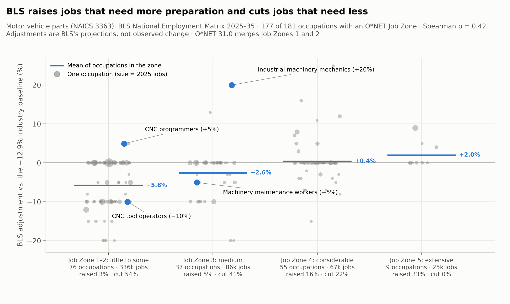

# Technical Documentation

## Manufacturing Talent Supply Chain II-A: Where Each Floor Job's Successors Come From (NAICS 3363)

II-A is exploratory and descriptive; it is **not** pre-registered. The occupation definitions it shares with II-B
(*From the Production Line to Maintenance*, pre-registered as *From the Line to Maintenance*, `config/prereg.yaml` v0.3
frozen 2026-10-18T19:11:28Z) are copied into `config/project.yaml`. Every analysis is recorded in
`outputs/analysis_log.md`: verbatim copies of the II-B log entries this repository runs or cites (DL-n), then entries
made here (AL-n).

---

## Table of Contents
1. System Architecture
2. Data Pipeline
3. Shared Definitions
4. BLS Projections inside NAICS 3363 (DL-14, DL-23, DL-28, DL-29, DL-34, DL-39)
5. Observed Industry Employment (DL-26)
6. Projection Track Record (DL-38, DL-40, DL-41)
7. Observed Mix inside NAICS 3363 (DL-29, DL-32)
8. Skill Content inside the Maintenance Family (DL-30, DL-32)
9. Succession Bench for Every Floor Position (DL-31 – DL-33)
10. CPS Age Profile and Flows (DL-44; data DL-37, readings DL-40, allocation rule DL-42)
11. Output Audit (E1 – E17) and DL-22
12. Analysis Log Summary
13. Code Reference
14. Repository Split: Mapping Tables (AL-1)
15. Troubleshooting
- Appendix A: Environment Setup (macOS + Anaconda)
- Appendix B: Requirements

---

## 1. System Architecture

### 1.1 Overview
```
data/raw (O*NET, OEWS May 2014 and 2021–2025, BLS EP 2025–35 and archive, CES, CPS 2020–2026, Census codes;
          SHA-256 of every file in MANIFEST.csv)
   │  scripts/check_downloads.py
   ▼
src.ingest_onet ─► DuckDB onet_ratings        (schema, row/occupation/element counts; Knowledge and Skills)
src.ingest_oews ─► DuckDB oews_3363           (May 2025; occupation re-validation with the shared selection rules)
src.ingest_ep   ─► DuckDB ep_*                (EP 2025–35, BLS crosswalk cross-check)
   ▼
src.mix         ─► outputs/mix/               (Table 1.12 factors, NEM 336300 two-stage reading, industry output,
                                               adjustment by Job Zone, automation counts; DL-14, 23, 28, 29, 34, 39)
src.trend       ─► outputs/trend/             (observed CES employment, DL-26)
src.history     ─► outputs/history/           (OEWS May 2021–2025 inside 3363; DL-29, 32)
src.skill_shift ─► outputs/skill_shift/       (levels, software, tasks inside maintenance; DL-30, 32)
src.floor_map   ─► outputs/floor_map/         (succession bench for every floor position; bootstrap, rule variants,
                                               link columns; DL-31–33)
src.track_record ─► outputs/track_record/     (archived BLS projections vs CES and OEWS; DL-38, 40, 41)
src.cps_flows   ─► outputs/cps_flows/         (age profile and flows, manufacturing; DL-44)
scripts/make_figures.py ─► figures/           (fig1–fig6, figS1)
src.output_audit ─► outputs/review/output_audit.*  (E1–E17 cross-path checks)
```
`run_pipeline.py` runs all steps in this order, stops at the first failure, and writes `results_log.txt`.
Neither repository reads the other's code or outputs (DL-36a); the functions both need are copied.

### 1.2 Consistency guards
- Ingest steps fail on any header, row-count, version-title or crosswalk mismatch (`strict_version_check: true`).
- The OEWS ingest re-applies the shared selection rules to May 2025 and stops if an occupation meets a rule without
  being in the frame (and without a documented design exclusion), so both repositories describe the same occupations.
- The floor map asserts that its matrix path reproduces the pair file and that the eligibility matrix reproduces the
  pair rule (DL-32).
- The output audit re-derives every reported number from the raw files by a second code path (section 11).

### 1.3 Configuration
`config/project.yaml` holds the data versions, the frame (maintenance targets, production feeders, sensitivity
occupations, negative control), the SOC → O*NET overrides, the O*NET scales and the Benjamini–Hochberg level, copied from
II-B's frozen `config/prereg.yaml`. Settings that belong to one analysis (thresholds, seeds, draws) are constants at the
top of its module and are logged in `outputs/analysis_log.md`.

---

## 2. Data Pipeline

### 2.1 O*NET 31.0 (CSV)
| File | Domain | Rows | Elements | Rater |
|---|---|---|---|---|
| knowledge.csv | K | 60,060 | 33 | Incumbent 653 / Occupational Expert 248 / Analyst-Transition 9 occupations |
| essential_skills.csv | S | 18,200 | 10 | Analyst |
| transferable_skills.csv | S | 45,500 | 25 | Analyst |

Rows = 910 occupations × elements × 2 scales (Importance IM 1–5, Level LV 0–7). In release 30.3 the single Skills file
was split into Essential and Transferable Skills; S is their union (35 elements). Further O*NET files: `job_zones.csv`
(Job Zone per occupation; release 31.0 merges zones 1 and 2 into '1–2', coded 2 here), `software_skills.csv` and
`task_statements.csv` (DL-30). Abilities are not used here (they are II-B's negative-control domain).

### 2.2 OEWS, national industry-specific
`oesm25in4.zip` → `nat4d_M2025_dl.xlsx`; `AREA = 99`, `NAICS = 336300`; total employment 538,980 (checked). Non-numeric
tokens (`*`, `**`) become missing. OEWS publishes 51-2090 (and 13-1020) both as a broad and a detailed row with identical
values; one row is kept. May 2021–2024 (`oesm21in4.zip` … `oesm24in4.zip`) and May 2014 (`oesm14in4.zip`) are read from
their zips with the same rules (sections 6 and 7).

### 2.3 BLS Employment Projections
- `occupation.xlsx` → Table 1.10 (separations, openings) and Table 1.12 (factors affecting occupational utilization);
  title must contain "2025–35".
- `education.xlsx` → Table 5.4, read with `keep_default_na=False` so the category "None" stays text.
- `nem-onet-to-soc-crosswalk.xlsx` → "As of 08/27/2026" required.
- `National_Employment_Matrix_IND_336300.csv` (NEM export for NAICS 336300) and `industry.xlsx` (Tables 2.6, 2.8, 2.10,
  2.11) — section 4.
- `ep_archive/2008-18.zip` … `2014-24.zip` — section 6.

### 2.4 CES and CPS
- CES series CEU3133630001 (NAICS 3363, all employees, not seasonally adjusted, thousands): `ces/` from 2016 (section 5)
  and `ces_2008/` from 2008 (section 6).
- CPS basic monthly public-use files, January 2020 – September 2026 (80 files; October 2025 was not collected), and the
  2018 Census occupation and 2017 / 2022 Census industry code lists (section 10).

### 2.5 Crosswalk cross-check
For every frame SOC code, every O*NET code BLS assigns to it must be mapped in `config/project.yaml` (primary or
sensitivity) or listed in `excluded_codes` with a reason. Result: 23/23 OK. One-to-many cases: 51-2028 → 51-2022.00 +
51-2023.00 (equal-weight profile mean); 51-2090 → 51-2092.00 (51-2099.00 excluded, no ratings); 17-3024 → .00 (.01
sensitivity); 17-3026 and 53-7062 → .00 (the .01 / .04 codes excluded as distinct occupations).

---

## 3. Shared Definitions
**Maintenance family** (II-B's registered targets, selected by rule on OEWS May 2025 before any KSA computation):
49-9041 industrial machinery mechanics, 49-9071 maintenance and repair workers (general), 47-2111 electricians, 49-9043
maintenance workers (machinery), 49-9044 millwrights — the equipment maintenance, repair and electrical occupations with
≥ 1,000 jobs and RSE < 10% in NAICS 336300. The **production feeders** of II-B (SOC 51 detailed, ≥ 4,000 jobs, RSE < 10%,
not 'All Other') appear here only as rows of the BLS and OEWS tables and of the track record.

**Distance and percentile** (the estimator of II-B, used by the floor map on Skills): with $z_{ok}$ the Level of element
$k$ standardized over all 910 occupations (sample SD) and target weights $w_{Tk} = I_{Tk} - 1 \in [0, 4]$,

$$
D(S \to T) = \frac{\sum_k w_{Tk}\,\max(0,\; z_{Tk} - z_{Sk})}{\sum_k w_{Tk}}, \qquad
P(S \to T) = \frac{100}{|R_T|} \sum_{o \in R_T} \mathbf{1}\big[D(o \to T) \le D(S \to T) + 10^{-12}\big]
$$

with $R_T$ = all O*NET occupations except T's own codes. D counts only the target's shortfalls; P is the share of
occupations at least as close. The tolerance $10^{-12}$ makes a position's own row count as a tie (DL-22).

---

## 4. BLS Projections inside NAICS 3363 (DL-14, DL-23, DL-28, DL-29, DL-34, DL-39)
`python -m src.mix` → `outputs/mix/`. BLS projections and BLS's stated reasons; descriptive.
- **BLS factors** (`bls_factors.csv`, DL-14): EP Table 1.12 text for each maintenance target, sensitivity target, core
  feeder and 51-9162: the NAICS 336300 row, else the all-industry (TE1000) row, else `no entry` (then the other
  industries with a factor are listed).
- **Within-industry projections** (`nem_336300.csv`, DL-23): BLS National Employment Matrix export for NAICS 336300 (codes
  written as `="xx-xxxx"` are unquoted; employment in thousands as published). For targets, feeders and context
  occupations: 2025 and 2035 employment, change, percent of industry, and percent change minus the industry's (−13.9%).
  The NEM 2025 base (524.7k) is never mixed with OEWS (538,980) in a ratio.
- **Two-stage reading (DL-28):** `baseline_change_pct` = the modal percent change among the 181 line items (−12.9%, 95
  items, 65% of 2025 jobs); `bls_adjusted` = change ≠ baseline; `bls_adjustment_pct`
  $= 100\,[(1 + c/100)/(1 + b/100) - 1]$. The baseline set is exactly the set of line items without a Table 1.12 row for
  336300 or all industries (E9), which is what BLS's share-rescaling method implies. Figure 3.
- **Automation factors** (`automation_factor_occupations.csv`, `automation_factor_groups.csv`, DL-28): Table 1.12 rows
  whose text matches `robot|automat` (case-insensitive); direction from "share increases / decreases"; an occupation is up,
  down or mixed across its matching rows. 242 rows, 112 occupations (105 down, 7 up, 0 mixed). Counts are per occupation
  because one sentence is repeated across industries (49-9041: 43 rows).
- **Automation share of the adjustments** (`cites_automation` in `bls_adjustment_by_occupation_job_zone.csv`, DL-39): of
  the 86 line items adjusted by more than ±0.05 points, 42 (5 up, 37 down; 49.8% of the adjusted 2025 jobs) have a Table
  1.12 factor for 336300 or all industries matching the same pattern.
- **Industry output** (`industry_output.csv`, DL-29): EP Table 2.11 rows TE1000, 31-330, 336100, 336200, 336300:
  employment and real output 2025 / 2035, output change and output-per-job change $(O_{35}/E_{35})/(O_{25}/E_{25}) - 1$;
  position of 336300 in Tables 2.6, 2.8 and 2.10 (row 0 = total). Auto parts: output 246.7 → 186.0 bn chained 2017
  dollars, output per job −12.4% (motor vehicles +17.8%); output per job falls in 4 of the 125 industries with output, most
  in auto parts.
- **Job Zone pattern** (`bls_adjustment_by_occupation_job_zone.csv`, `bls_adjustment_by_job_zone.csv`, DL-34; Figure S1):
  for each NEM 336300 line item, the BLS adjustment above; Job Zone = the highest Job Zone among the O*NET codes the BLS
  crosswalk maps to the NEM code; line items without a mapped zone are counted and left out. Up / down: adjustment above
  +0.05 / below −0.05 points.

| Job Zone | Line items | Jobs 2025 (k) | Mean adjustment | Employment-weighted | Raised | Cut |
|---|---|---|---|---|---|---|
| 2 | 76 | 336.2 | −5.8% | −2.9% | 3% | 54% |
| 3 | 37 | 85.8 | −2.6% | +1.0% | 5% | 41% |
| 4 | 55 | 67.1 | +0.4% | +2.0% | 16% | 22% |
| 5 | 9 | 24.7 | +2.0% | +6.4% | 33% | 0% |

177 of 181 line items have a zone; Spearman ρ = 0.42 (p = 5.7e-09). Industrial machinery mechanics (49-9041) and
machinery maintenance workers (49-9043) are both Job Zone 3, so the within-maintenance contrast is not a Job Zone contrast.
The adjustments are BLS judgments, so the pattern describes the projection, not observed demand. The README states it in
one sentence; Figure S1 is kept in this document only.



---

## 5. Observed Industry Employment (DL-26)
`python -m src.trend` → `outputs/trend/ces_3363_monthly.csv`, `ces_3363_annual.csv`. BLS CES CEU3133630001, not
seasonally adjusted, thousands. Annual average = mean of 12 months; incomplete years flagged. The 2025 average (524.69k)
equals the NEM 2025 base (524.7k), consistent with CES supplying the NEM industry total (E3). Figure 1.

---

## 6. Projection Track Record (DL-38, DL-40, DL-41)
`python -m src.track_record` → `outputs/track_record/`. Archive matrices (line item 00-0000 × 336300; 2008–18 in jobs,
later vintages in thousands) against CES annual averages of complete calendar years (`ces_annual_2008_2026.csv`).
Figure 2.

| Vintage | Archive base / CES base (k) | Projected change | Actual change | Error in target year | Direction |
|---|---|---|---|---|---|
| 2008–18 | 544.4 / 543.7 | −18.6% | +10.3% | −26.1% | wrong |
| 2010–20 | 415.1 / 418.9 | −4.9% | +26.6% | −25.5% | wrong (pandemic target year) |
| 2012–22 | 479.6 / 482.8 | +5.8% | +14.3% | −8.0% | right |
| 2014–24 | 536.6 / 537.0 | −4.2% | +2.6% | −6.7% | wrong |

Occupations, 2014–24 (`occupation_2014_24.csv`, `frame_2014_24.csv`): 144 of 176 line items compared (18 without a
one-to-one SOC match, 14 without numeric OEWS May 2024 employment); direction right 30.6% (35.6% employment-weighted);
Spearman 0.19; share error 35.40 (BLS) vs 35.47 (constant share). Not used to judge BLS occupational projections (DL-41:
OEWS hybrid SOC in May 2019–2020, MB3 method from May 2021).

---

## 7. Observed Mix inside NAICS 3363 (DL-29, DL-32)
`python -m src.history` → `outputs/history/`. Inputs: `data/raw/oews_history/oesm21in4.zip` … `oesm24in4.zip` and
`data/raw/oews/oesm25in4.zip`; member `nat4d_M<year>_dl.xlsx` read from the zip; columns upper-cased (the 2021 file uses
lower case); NAICS 336300 only; numeric parsing and duplicate resolution as in the ingest.
- `oews_3363_2021_2025.csv`: every detailed occupation (plus 51-2090 and the total) × year: employment, employment RSE,
  hourly and annual means and medians.
- `maintenance_mix.csv`: per year, the five targets, context occupations (51-9162, 17-3024, 51-1011, 51-4111), the
  family and the industry total: employment, RSE, share of industry, share of family, annual median, mean hourly wage and
  its RSE, and the premium of 49-9041 over each other target on mean hourly wage (published RSE) and on annual median (no
  published error). Change with $z = \Delta / \sqrt{SE_{2021}^2 + SE_{2025}^2}$, $SE$ = employment × RSE (independence
  assumed; each May estimate pools six semiannual panels over three years, so May 2021 / May 2022 and May 2025 share none;
  [OEWS technical notes](https://www.bls.gov/oes/2025/may/oes_tec.htm)). `PERIODS = ((2021, 2025), (2022, 2025))`;
  `premium_mean_change_z` $= \Delta \ln(w_{49\text{-}9041}/w_{c}) \,/\, (\sqrt{\sum \mathrm{RSE}^2}/100)$ over the four
  estimates (DL-32). The close-feeder pool of II-B is not part of this file (DL-36e). Figure 4.

| Result (NAICS 3363) | 2021 | 2025 | Change |
|---|---|---|---|
| Maintenance family (5 targets) | 29,130 | 27,330 | −6.2% |
| 49-9041 industrial machinery mechanics | 11,770 (40.4% of family) | 13,210 (48.3%) | +12.2% (z 4.4) |
| 49-9043 machinery maintenance workers | 3,570 | 1,690 | −52.7% (z −15.4) |
| 49-9041 mean-wage premium over 49-9043 / 49-9071 | +13.7% / +18.9% | +8.1% / +4.3% | z of the 49-9043 change: −5.1 from 2021, −0.2 from 2022 |

---

## 8. Skill Content inside the Maintenance Family (DL-30, DL-32)
`python -m src.skill_shift` → `outputs/skill_shift/`. Exploratory.
- `level_differences.csv`: 49-9041 minus 49-9043, 49-9071, 49-9044 and 47-2111 on every Skills and Knowledge element
  (Level scale), SE from the published rating SEs, no imputation (49-9044 Knowledge is expert-rated without SE). Counts
  with |z| > 1.96: vs 49-9043 17 higher / 1 lower of 65 with SE; vs 49-9071 7 / 3 of 64; vs 49-9044 8 / 8 of 30; vs
  47-2111 5 / 12 of 65.
- Multiple comparisons (DL-32): two-sided $p = 2\,\Phi(-|z|)$; Benjamini–Hochberg within each comparison at `fdr_q` =
  0.05; Bonferroni. Higher / lower, BH: vs 49-9043 14 / 1; vs 49-9071 4 / 0; vs 49-9044 2 / 6; vs 47-2111 3 / 10.
  Bonferroni: 8 / 0, 2 / 0, 0 / 0, 3 / 8. BH controls the FDR under independence or positive dependence (Benjamini &
  Yekutieli, 2001).
- `software_and_tasks.csv`: Software Skills (examples, categories, Hot Technology, In Demand, 'Industrial control
  software' examples) and Task Statements (tasks, core tasks, keyword matches) for the five targets, the Skills close
  feeders of II-B, 51-9162, 17-3024.00 and 17-3024.01. Keyword patterns are fixed in `TASK_PATTERNS`.

---

## 9. Succession Bench for Every Floor Position (DL-31 – DL-33)
`python -m src.floor_map` → `outputs/floor_map/`. Exploratory, point estimates, Skills only. Figure 6.
- **Positions:** detailed OEWS May 2025 occupations in NAICS 336300 with SOC prefix 51, 49, 53, 47 or 17-3 and at least
  1,000 jobs (34); 33 with an O*NET Skills profile (51-9199 has none). O*NET codes: the overrides in
  `config/project.yaml`, then the BLS O*NET-SOC ↔ NEM crosswalk restricted to rated codes (equal-weight profile mean);
  17-3027 → 17-3027.00 + .01, 53-1047 → 53-1042.00 + 53-1043.00 (`EXTRA_CODES`).
- **Pairs:** for target T, $D(S \to T)$ and $P(S \to T)$ as in section 3.
- **Eligible successor:** OEWS May 2025 median annual wage of S < that of T and Job Zone(S) ≤ Job Zone(T) (maximum over
  codes). **Close:** eligible and $P \le 25$. **Stability:** share of 400 half-sets (200 random half-splits of the 35
  Skills elements, seed 20261021) with $P \le 25$.
- `succession_pairs.csv`: 33 × 32 = 1,056 pairs with D, P, eligibility, closeness, stability, source jobs, wage, Job
  Zone, NEM change and BLS adjustment. `position_summary.csv`: per position, eligible and close sources, close-source jobs,
  bench ratio (close-source jobs / position jobs), top three eligible successors, observed 2021–25 change of the close
  successor roles (from `outputs/history/oews_3363_2021_2025.csv`), the unrestricted nearest source, and flags.
- **Checks (DL-32).** `pair_matrices` gives P for all position pairs (asserted equal to the pair file);
  `eligibility_matrix` reproduces `eligible`. Bootstrap: Skills Level and Importance redrawn as in II-B's registered
  bootstrap (truncated normal, published SE; B = 200, seed 20261022), z and profiles recomputed, wages and Job Zones fixed
  → `floor_bootstrap.csv` (share of draws close and P quantiles per eligible pair) and `boot_*` columns in
  `position_summary.csv`, plus `close_pool_change_2022_2025_pct`. Rule variants → `rule_variants.csv`.
- **Cross-part link columns (DL-33).** Per position: `n_positions_as_close_source` (positions it is a close successor
  for), `n_maintenance_targets_as_close_source`, the bootstrap median and 95% range of the first
  (`boot_n_positions_as_close_source_*`), and `close_source_jobs_soc51_pct` (production share of its own close pool).

| Result | Value |
|---|---|
| Positions mapped | 33 (387,910 jobs, 72% of OEWS 336300) |
| Unrestricted nearest source earns more than the position | 31 of 33 (why the successor rule is needed) |
| No close internal successor: base rule / bootstrap median [95%] | 11 (200,180 jobs) / 11 [10, 12] |
| Same count under P ≤ 15 / P ≤ 35 / wage only / Job Zone only / < 110% wage / Knowledge | 17 / 9 / 11 / 0 / 4 / 8 |
| Close pairs at the point estimate; close in < 80% of draws | 98; 23 |
| Bench ratio, maintenance targets | 3.9 (49-9041) – 60.4 (49-9043) |
| Production supervisors' bench: Skills / Knowledge; rank among 12 Job Zone ≥ 3 positions (thinnest = 1) | 0.34 / 6.09; 2 (17-3026 has none) |
| CNC tool operators as a close source | 13 positions (bootstrap 11–13), all five maintenance targets |
| Production share of the close pool | 49-9041 66%, 49-9071 92%, 49-9043 98%, 49-9044 100%, 47-2111 51% |

---

## 10. CPS Age Profile and Flows (DL-44; data DL-37, readings DL-40, allocation rule DL-42)
`python -m src.cps_flows` → `outputs/cps_flows/`; cache `data/interim/cps_adults.npz` (rebuilt with `--rebuild`).
Manufacturing as a whole: NAICS 3363 is not identifiable in the CPS. 6,539,550 civilian adult records (PRPERTYP 2, age
16+, PEMLR 1–7) read as fixed-width records of 1,000 characters; 4,326,472 linked pairs (link rate 88.5–90.2% by year, all
statuses). Linking: same HRHHID, HRHHID2 and PULINENO in consecutive calendar months, month in sample +1 and not 1 or 5,
same sex, age +0 or +1. Code groups (DL-40b): M = 6355, 7330, 7340, 7350, 7360; machinists 8030; mixed codes 7905 and 8225
reported separately; P = codes whose SOC begins 51-; manufacturing = Census industry codes with NAICS 31–33. Weight
PWCMPWGT (at t for pairs). Intervals: household-cluster bootstrap, B = 1,000, seed 20261029; NCHS presentation rule for
proportions. A2 and A3 headline = pairs without an allocated occupation, industry (when employed) or labour-force status
(PXMLR) in either month (the DL-42 rule). Figure 5.

The fixed-width parser equals plain string slicing of the raw lines (test `test_fast_parser_matches_string_slicing`).
The employed-records linker of E15 also counts 74 production pairs in which the person is 15 in one of the two months
(none of them an event; their composite weight is 0); E15 removes them before comparing with A2.

| A1: share aged 55+ (employed, pooled January 2020 – September 2026) | Estimate [95%] | Records |
|---|---|---|
| Maintenance, five target codes (manufacturing) | 28.6% [26.8, 30.4] | 12,843 |
| Machinists, 8030 | 31.8% [29.1, 34.4] | 6,712 |
| CNC operators with programmers, 7905 | 24.0% [19.5, 28.5] | 1,794 |
| Multiple machine setters with other metal workers, 8225 | 25.7% [23.6, 27.9] | 7,410 |
| Other production | 23.9% [23.3, 24.5] | 112,171 |
| All production | 24.4% [23.9, 25.0] | 128,087 |
| All employed in manufacturing | 25.6% [25.3, 26.0] | 349,998 |
| All employed, every industry | 23.5% [23.3, 23.6] | 3,765,898 |

By year (2020 → 2026), the 55+ share stays within 27.1–30.6% for maintenance and 23.7–25.2% for production, with
overlapping intervals: no trend is visible over these seven years.

| A2: production workers in manufacturing, status a month later (headline, n = 80,890) | All ages, % [95%] | Aged 55+, % |
|---|---|---|
| Same occupation code, manufacturing | 90.98 [90.72, 91.23] | — |
| Other production code, manufacturing | 2.13 [2.00, 2.26] | 1.80 |
| Maintenance, manufacturing | 0.10 [0.08, 0.12] | 0.09 |
| Other occupation, manufacturing | 1.35 [1.26, 1.45] | — |
| Maintenance, other industry | 0.04 [0.02, 0.06] | — |
| Other occupation, other industry | 1.82 [1.72, 1.95] | 1.32 |
| Unemployed | 1.34 [1.25, 1.44] | 1.00 |
| Retired | 0.44 [0.39, 0.49] | 1.57 [1.40, 1.76] |
| Disabled | 0.25 [0.21, 0.29] | — |
| Other not in the labour force | 1.55 [1.44, 1.66] | — |

| A3: maintenance in manufacturing, per 100 workers a month (headline) | All ages | 16–34 | 35–54 | 55+ |
|---|---|---|---|---|
| Inflow from production | 1.07 [0.83, 1.33] | 1.40 | 1.01 | 0.85 |
| Inflow from outside the labour force | 1.02 | 1.25 | 0.66 | 1.35 |
| Outflow to retirement | 0.50 [0.33, 0.68] | 0.05 | 0.09 | 1.50 [0.98, 2.11] |
| Outflow to production | 1.13 | 1.34 | 1.12 | 0.95 |

Inflow from production ÷ outflow to retirement (weighted, all ages): 2.14 [1.40, 3.44] headline; 2.12 all pairs; 2.18
with the reversal check; 1.71 [1.03, 3.01] excluding March 2020 – December 2021. All inflow ÷ all outflow: 0.91
[0.80, 1.04] headline; 0.86 [0.73, 0.99] excluding 2020–2021. Monthly gross flows are large in both directions: among
workers aged 55+, the outflow to retirement (1.50 per 100) is close to the inflow from outside the labour force (1.35),
which includes returns from retirement and reporting error (Poterba & Summers, 1986). The gross flows therefore cannot be
turned into annual retirement counts; the ratios compare two gross flows over the same linked pairs.

**Reading the checks.** (i) Reversal (a move is dropped when the person is back in the origin state at t+1) lowers the
A2 exits from 9.0% to 8.5% of pairs and leaves the A3 ratio at 2.18. (ii) Excluding 2020–2021 lowers unemployment exits
(1.34 → 1.01), other non-participation (1.55 → 1.44) and the A3 ratio (2.14 → 1.71); the A2 moves into other jobs,
maintenance and retirement change by 0.04 points or less.

---

## 11. Output Audit (E1 – E17) and DL-22
`python -m src.output_audit` → `outputs/review/output_audit.{csv,md}`; exit code 1 if any check is FLAG.

| ID | Check |
|---|---|
| E1 | Analysis log: the DL rows are exactly the shared set and their SHA-256 equals the copy made at the split; AL ids contiguous and unique |
| E2 | Figures newer than the outputs they draw |
| E3 | CES file: series id, not seasonally adjusted, consecutive months, annual averages re-derived, SHA-256 in MANIFEST; 2025 annual average equals the NEM 2025 total within 0.05k |
| E4 | NEM 336300: parse, Σ major groups = total, group = sum of parts, change = 2035 − 2025, % change recomputed, SHA-256 in MANIFEST, output equals source |
| E5 | NEM 2025 vs OEWS May 2025 inside 3363: share correlation > 0.999, max share difference < 0.1 point, level ratio of occupations ≥ 5,000 jobs within 0.01 of the total ratio |
| E6 | Projection track record (DL-38): archive totals re-read as raw text / openpyxl, CES annual averages with openpyxl; errors and directions recomputed; occupation metrics recomputed from the comparison file |
| E7 | Industry output (DL-29): Table 2.11 = Table 2.8 for 336300; Table 2.11 employment = NEM 336300 totals; ranks; output per job; SHA-256 in MANIFEST |
| E8 | Table 1.12 factor text and levels against the raw workbook (DL-14) |
| E9 | Two-stage NEM reading (DL-28): baseline = mode; at baseline ⇔ no Table 1.12 row for 336300 or all industries (95 + 86 of 181); adjustments re-derived; automation counts re-derived row by row and matched to `mix_summary.md` |
| E10 | Automation share of BLS adjustments (DL-39): adjusted NEM 336300 line items and those whose Table 1.12 factor for 336300 or all industries mentions robots or automation re-derived from the raw Table 1.12 (openpyxl) and the raw NEM CSV (csv module) |
| E11 | Job Zone pattern (DL-34): baseline, adjustments, Job Zone per line item (highest mapped zone, '1–2' coded 2), per-zone means and Spearman ρ re-derived with the `csv` module from the raw NEM CSV, the crosswalk workbook and `job_zones.csv` |
| E12 | OEWS history (DL-29): May 2021 and 2025 employment and mean wages re-read from the raw zips; 2025 equals the `oews_3363` ingest; 2021–2024 SHA-256 in MANIFEST |
| E13 | Skill shift (DL-30): 49-9041 vs 49-9043 differences and z re-derived from the raw O*NET CSVs; industrial-control software counts re-derived with the `csv` module |
| E14 | Multiple comparisons and rule choice (DL-32): BH re-derived by a step-up search for 49-9041 vs 49-9043; premium z for 49-9043 re-derived from the yearly OEWS file for both start years; floor-map no-close counts under four rules re-derived from the pair file; bootstrap pairs equal the eligible pairs |
| E15 | CPS age profile and flows (DL-44): A1 counts and weighted 55+ shares, A2 and A3 counts re-derived with string slicing and dict-based linkers over every civilian adult; A2 restricted to pairs employed at t equals the production → maintenance pairs of an employed-records linker once pairs with a person under 16 are removed |
| E16 | Floor succession map (DL-31): D and P for targets 49-9041 and 51-1011 re-derived from the raw O*NET CSVs (max difference 1.4e-14); eligibility re-derived from OEWS wages and Job Zones; close counts match the pair file |
| E17 | Cross-part link columns (DL-33): each position's count as a close source, its count over the five maintenance targets and the production (SOC 51) share of each close pool re-derived from the pair file; Σ as-source counts = Σ close-source counts |

**DL-22.** The reference set contains each position's own O*NET row, so P counts a self-tie by design. Building a
profile from a column-sliced matrix can change D by about 1e-16 and drop that tie, so the floor map builds on the full
element set and compares with a tolerance of 1e-12 (`TIE_TOL` in `src/onet_arrays.py`).

---

## 12. Analysis Log Summary
| ID | Type | Content |
|---|---|---|
| DL-14 | descriptive addition | BLS EP Table 1.12 factors (336300 row, else all-industry row, else none) |
| DL-22 | correction | Self-tie tolerance 1e-12 in non-registered modules (and other audit fixes in II-B) |
| DL-23 | descriptive addition (new input) | BLS National Employment Matrix for NAICS 336300: projected change inside the industry |
| DL-26 | descriptive addition (new input) | Observed CES employment for NAICS 3363 |
| DL-28 | descriptive addition | Two-stage reading of NEM 336300 (industry baseline + BLS adjustment); Table 1.12 automation factors counted per occupation |
| DL-29 | descriptive addition (new inputs) | OEWS May 2021–2024 + EP industry workbook: observed mix inside 3363, 2021–2025; industry output |
| DL-30 | exploratory addition (new inputs) | O*NET Software Skills and Task Statements: skill content inside the maintenance family |
| DL-31 | exploratory addition | Succession bench for every floor position with ≥ 1,000 jobs; successor = lower-paid role with the same or lower Job Zone |
| DL-32 | setting + robustness | Benjamini–Hochberg at `fdr_q` on the skill-shift tests (and H1 in II-B); 2022 endpoint and premium z for the OEWS changes; floor-map bootstrap and rule variants |
| DL-33 | descriptive addition | Cross-part link columns in the floor map |
| DL-34 | descriptive addition | BLS adjustment by O*NET Job Zone for all 181 NEM 336300 line items |
| DL-36 | repository organization | Split into II-A and II-B; neither reads the other's outputs |
| DL-37 | exploratory addition (planned) | CPS matched months (the data and linking used by DL-44; Q1–Q3 run in II-B) |
| DL-38 | descriptive addition (planned) | Track record of BLS projections for NAICS 3363 (industry and 2014–24 occupations) |
| DL-39 | correction + scope decision | README 'most adjustments cite automation' replaced by the count (42 of 86 adjusted line items, 49.8% of adjusted jobs) |
| DL-40 | clarification + one added check | Readings of DL-37 and DL-38 fixed before computing (Census code groups, linking, NCHS rule; archive values) |
| DL-41 | disclosure after results | The 2014–24 occupation comparison crosses the OEWS 2018 SOC hybrid years and the 2021 MB3 method change |
| DL-42 | post-hoc interpretive change | CPS headline = estimate without allocated codes (the rule A2 and A3 use) |
| DL-44 | exploratory addition | Age profile (A1), destinations of production workers (A2), maintenance inflow and outflow (A3), manufacturing |
| AL-1 | repository organization | Split executed: modules, outputs, labels, figures and audit renumbered; equality check with the single repository |

---

## 13. Code Reference
| Module | Purpose |
|---|---|
| `src/config.py` | loads `config/project.yaml`; repository paths |
| `src/frame.py` | roles, SOC → O*NET resolution, aggregation rules |
| `src/ingest_onet.py`, `src/ingest_oews.py`, `src/ingest_ep.py` | validated ingest into DuckDB |
| `src/deficit.py` | pure estimator functions (z, weights, contributions, D) |
| `src/onet_arrays.py` | rating arrays, Knowledge SE imputation, truncated-normal draws, `TIE_TOL` (copied from II-B) |
| `src/stats.py` | Benjamini–Hochberg adjusted p (copied from II-B) |
| `src/mix.py` | BLS factors, NEM 336300 two-stage reading, industry output, adjustment by Job Zone, automation counts |
| `src/trend.py` | observed CES employment, NAICS 3363: monthly series and annual averages |
| `src/history.py` | OEWS May 2021–2025 inside 3363: employment, RSE, wages, maintenance mix, endpoint z |
| `src/skill_shift.py` | 49-9041 vs other targets: level differences, software skills, task statements |
| `src/floor_map.py` | succession bench for every floor position: pairs, eligibility, close successors, stability, bootstrap, rule variants, link columns |
| `src/track_record.py` | archived BLS projections for NAICS 3363 vs CES; 2014–24 occupation comparison |
| `src/cps_codes.py` | CPS record layout, code sets, linking keys, NCHS rule (copied from II-B) |
| `src/cps_flows.py` | every civilian adult in matched CPS months: age profile, destinations of production workers, maintenance inflow and outflow |
| `src/output_audit.py` | E-checks: re-derivation and cross-path agreement of every reported output |
| `scripts/make_figures.py` | Figures 1–6 and S1 from the outputs |

---

## 14. Repository Split: Mapping Tables (AL-1)
The single repository was split on 2026-10-29 (DL-36, AL-1). Every number present both in the single-repository outputs
and here is identical (exact for counts and text, within 1e-12 for floats), apart from the relabelled values listed below.

**Figures**

| Single repository | II-A | Change |
|---|---|---|
| fig9_observed_trend | fig1_observed_trend | number only |
| fig13_projection_track_record | fig2_projection_track_record | number only |
| fig6_automation_shift | fig3_automation_shift | number only |
| fig10_maintenance_mix | fig4_maintenance_mix | close-feeder pool line removed; wage panel compares 49-9041 with the other four maintenance jobs only; title |
| fig15_cps_aging_flows | fig5_cps_aging_flows | number only |
| fig11_floor_bench | fig6_floor_bench | number only |
| fig12_adjustment_by_job_zone | figS1_adjustment_by_job_zone | Technical Documentation only |

**Audit checks**

| Single repository | II-A | Change |
|---|---|---|
| E12 | E1 | analysis log instead of deviation log: shared DL rows and their hash, AL ids |
| E13 | E2 | II-A figures |
| E17 | E3 | — |
| E14 | E4 | — |
| E15 | E5 | — |
| E29 | E6 | — |
| E22 | E7 | — |
| E9 | E8 | — |
| E19 | E9 | reads `outputs/mix/mix_summary.md` |
| E28 | E10 | reads `outputs/mix/mix_summary.md` |
| E26 | E11 | — |
| E20 | E12 | — |
| E21 | E13 | — |
| E24 | E14 | H1 part runs in II-B (its E20) |
| E32 | E15 | A2 compared with an employed-records linker in the same pass instead of II-B's Q1 output |
| E23 | E16 | — |
| E25 | E17 | — |

**Outputs**

| Single repository | II-A |
|---|---|
| `outputs/practice/bls_factors.csv`, `nem_336300.csv`, `industry_output.csv`, `bls_adjustment_by_occupation_job_zone.csv`, `bls_adjustment_by_job_zone.csv` | `outputs/mix/` (same names) |
| automation-factor tables printed in `practice_summary.md` | `outputs/mix/automation_factor_occupations.csv`, `automation_factor_groups.csv`; summary in `mix_summary.md` |
| `outputs/practice/ces_3363_annual.csv`, `ces_3363_monthly.csv` | `outputs/trend/` |
| `outputs/history/maintenance_mix.csv` | same, without the close-feeder rows and the close-pool series (DL-36e) |
| `outputs/floor_map/rule_variants.csv` | same; 'registered: …' → 'base: …', '(registered rule)' → '(base rule)', 'registered rule, Skills ratings redrawn …' → 'base rule, …' |
| `outputs/track_record/frame_2014_24.csv` | same; role 'registered feeder' → 'production feeder (II-B frame)' |
| `outputs/validation/oews_feeders_threshold_alt.csv` | not produced (II-B multiverse) |
| `outputs/deviation_log.md` | `outputs/analysis_log.md` (DL copies + AL entries) |

---

## 15. Troubleshooting
| Message | Cause | Fix |
|---|---|---|
| `header mismatch` / `rows=… expected=…` | wrong O*NET release or a file re-saved in Excel | re-download O*NET 31.0 CSVs |
| `title does not contain '2025–35'` | older EP workbook | download the current EP tables |
| `meets the feeder rule but is not in feeders_core` | different OEWS release | use May 2025 |
| `[skip] … not found` | an optional input is missing | download it (see `docs/DATA_DOWNLOAD_GUIDE.md`) or accept the skipped layer |
| `record length is not 1000` | a CPS file from another layout or a damaged download | re-download the monthly file |
| `knowledge_1.csv` / `knowledge (1).csv` | browser renamed the download | rename to `knowledge.csv` |

---

## Appendix A: Environment Setup (macOS + Anaconda)
```bash
cd path/to/repo
/opt/anaconda3/bin/python -m venv .venv
source .venv/bin/activate
pip install -r requirements.txt
python run_pipeline.py
```

## Appendix B: Requirements
`pandas`, `numpy`, `duckdb`, `PyYAML`, `openpyxl`, `scipy`, `matplotlib`, `tabulate`, `pytest` —
versions in `requirements.txt`.
